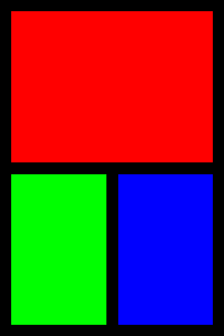

# pydevices

pydevices is the part of OmniPython that talks to hardware: displays, touch,
audio, USB, Bluetooth LE, Wi-Fi and timers, with one board config per board
and the same program on MicroPython-compatible boards, CircuitPython-compatible
boards, a desktop, a browser and an Android phone.

```bash
pip install -i https://test.pypi.org/simple/ --extra-index-url https://pypi.org/simple/ pydevices-desktop
```

```python
import mip
mip.install("github:PyDevices/pydevices/board_configs/fbdisplay/esp32-p4-wifi6-touch-lcd-4b",
            index="https://PyDevices.github.io/mip")
```

The first is for a desktop. The second installs one board's config on that
board, and pydevices with it; [Install](docs/get-started/install.md) has every
board and channel.

```python
from board_config import display_drv

w, h = display_drv.width, display_drv.height
print("display:", w, "x", h)

display_drv.fill(0x0000)
display_drv.fill_rect(16, 16, w - 32, h // 2 - 24, 0xF800)
display_drv.fill_rect(16, h // 2 + 8, w // 2 - 24, h // 2 - 24, 0x07E0)
display_drv.fill_rect(w // 2 + 8, h // 2 + 8, w // 2 - 24, h // 2 - 24, 0x001F)
display_drv.show()
```

```text
display: 320 x 480
```

On a desktop that opens a window at the desktop config's 320 × 480 and draws
the picture at the top of this page. On a board it draws the same layout at
the size of its screen.

[Docs](https://github.com/PyDevices/pydevices/blob/main/docs/index.md) · [Examples](https://pydevices.github.io/pydevices-examples/pyscript/) · [Roadmap](ROADMAP.md)

OmniPython is made by [PyDevices](https://pydevices.com).
