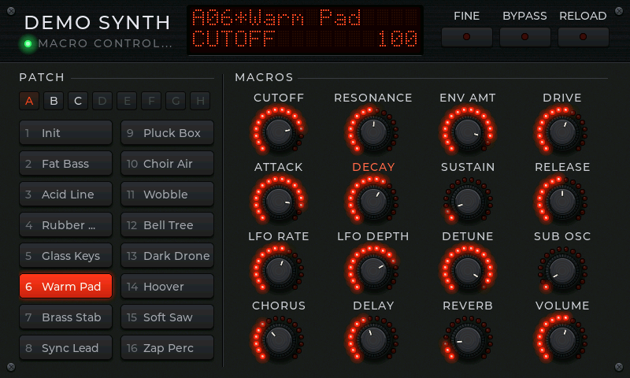
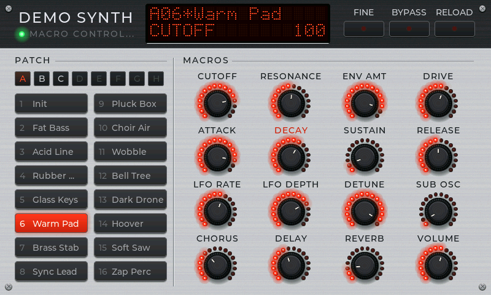

# controlpanel

controlpanel is the part of OmniPython that gives an instrument or an effect a
front panel: sixteen patch pads in eight banks, sixteen encoders with LED rings
and a dot-matrix display, drawn in LVGL on MicroPython-compatible boards,
CircuitPython-compatible boards and CPython.

```python
import mip
mip.install("controlpanel", index="https://pydevices.github.io/lib")
```

```bash
pip install -i https://test.pypi.org/simple/ --extra-index-url https://pypi.org/simple/ pydevices-controlpanel
```

It needs LVGL and nothing else. Run this on a desktop or a board with a
display:

```python
from display_driver import app

import controlpanel
from controlpanel.mock import MockAdapter

panel = controlpanel.build(MockAdapter())
app.run()
```

You get the panel at the top of this page. Press a pad and every encoder turns
to that patch's settings; turn an encoder and the display shows its value.

[Examples](examples) · [Roadmap](ROADMAP.md) · [Changelog](CHANGELOG.md)

## Connect it to your instrument

The panel edits through an adapter, an object you write that knows your
instrument. It needs these attributes and methods:

| | |
|---|---|
| `script_name` | The name on the faceplate |
| `macro_labels`, `macro_count` | Up to 16 labels, and how many of the 16 encoders are in use |
| `macro_values` | The 16 current values, MIDI 0 to 127 |
| `patches`, `patch_index` | Patch names (up to 128, so up to eight banks of 16) and the current one; an empty list hides the pads |
| `bypass`, `engine_ready`, `engine_error` | What the engine light and the display report |
| `set_macro(index, value)`, `set_patch(index)` | The user turned an encoder or pressed a pad |
| `set_bypass(enabled)`, `request_reload()` | The BYPASS and RELOAD buttons |
| `on_external_change(callback)` | Register `callback(kind, index, value)` for changes from elsewhere |

Call the callback with `("macro", index, value)` when a host's automation or
a controller moves a macro, and `("patch", index, index)` when the patch
changes from outside. The panel moves its encoders and pads to match and
publishes nothing back, so the two sides never chase each other. After a
patch change it reads `macro_values` again, so every encoder follows even if
your adapter reports only the patch.

`controlpanel/mock.py` is a complete adapter with no sound, and the source to
copy from.

## Play it

- Drag an encoder up or right to raise it. FINE makes a drag four times
  finer and the wheel step one at a time.
- Click an encoder, then use the wheel or the arrow keys. Quick notches turn
  it faster. Home and End go to the ends.
- Double-click an encoder, or press Backspace, to return it to the value the
  patch gave it. An asterisk after the patch number on the display means the
  sound has been edited away from the patch.
- The bank buttons A to H show another bank's pads without changing the
  sound; a pad press picks the patch.

## Options

`build(adapter, screen=None, group=None, theme=None, title=None,
subtitle=None, on_close=None)`. `theme` is `"black"` (above), `"silver"`, or
a dict of colours: copy one from `controlpanel/theme.py` and change what you
like. `on_close` adds an EXIT button that calls it.



The panel scales to its screen. From 800 x 480 up it shows everything; below
about 640 x 384 it drops the legends above the header buttons and the pad
numbers, and a 480 x 320 board still gets all 16 encoders and pads.

## What a frame costs

The artwork (knobs, LEDs, screws, the faceplate's grain) is painted once
per size and shared. After the first frame, turning an encoder one step
redraws about 570 pixels, 0.15% of an 800 x 480 screen: the LEDs that
changed and the pointer. On a desktop, unix MicroPython draws the whole
800 x 480 panel in about 7 ms and a one-step turn in under 0.1 ms. A
theme's `face_finish` and `header_finish` set to None skip the grain on a
slow board.

## Tests

From this folder:

```bash
python -m unittest discover -s tests -p 'test_*.py' -v
```

They build the real panel on a display with no window and drive it as a
host, a sequencer and a hand would, on CPython and on unix MicroPython
(`PYDEVICES_MICROPYTHON` names one with LVGL). One run puts back the old
handling of a patch change, which only moved the patch selector, and must
fail.

OmniPython is made by [PyDevices](https://pydevices.com).
