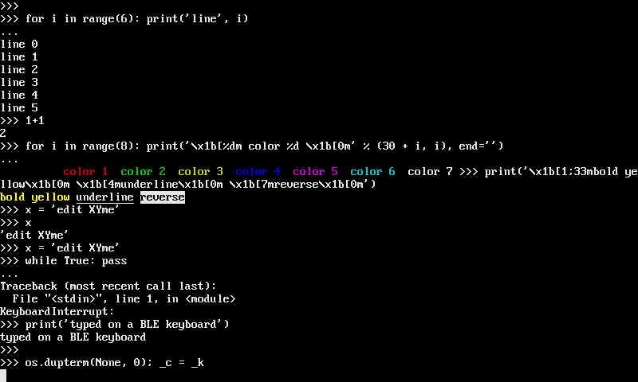
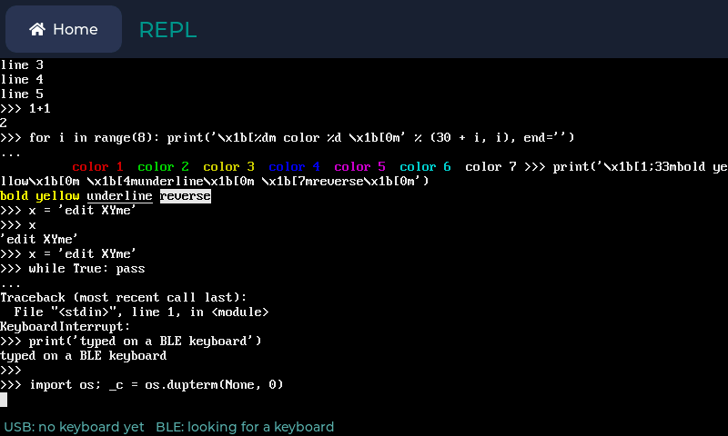
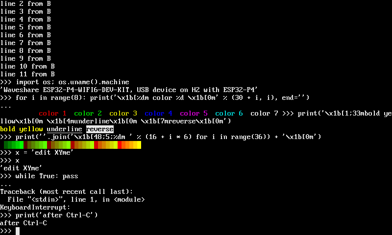

# vtterm: a terminal on a display



vtterm turns a display into a VT100 terminal with ANSI colors. Put the
board's own REPL on its screen and type on a USB or Bluetooth LE keyboard, or
show another device's session, on MicroPython-compatible boards,
CircuitPython-compatible boards and CPython. It draws only the rows that
change.

## Install it

On a board, with `mip`:

```python
import mip
mip.install("github:PyDevices/pydevices/packages/vtterm")
```

From a computer, `mpremote mip install github:PyDevices/pydevices/packages/vtterm`
does the same. On a CircuitPython-compatible board, copy the
[`packages/vtterm/vtterm`](https://github.com/PyDevices/pydevices/tree/main/packages/vtterm/vtterm)
folder to `CIRCUITPY/lib/`.

vtterm draws its characters with pygraphics and takes its 256 colors from
palettes' ANSI palette, `palettes.ansi`. OmniPython MP firmware has both built
in. If `import palettes.ansi` fails on your board, its firmware predates the
ANSI palette: update the firmware, since a built-in palettes wins over one
you copy to `/lib`.

On a desktop, install pygraphics from PyPI and put
`packages/vtterm` and `packages/palettes/lib` from a checkout of this
repository on the path:

```bash
pip install pydevices-pygraphics
PYTHONPATH=packages/vtterm:packages/palettes/lib python3 your_program.py
```

## Your first terminal

A terminal is three parts: a `Screen`, the grid of characters with their
colors; a `Parser`, which reads the bytes a program sends and changes the
grid; and a renderer, which draws the grid on a display. This program uses
the first two, so it runs anywhere, with no display:

```python
from vtterm import Parser, Screen
from vtterm.screen import BOLD

screen = Screen(cols=24, rows=4)
parser = Parser(screen)

# What a program sends: colored text, a new line, then a cursor move
# and an erase that rewrite part of the first row.
parser.feed(b"\x1b[1;32mready\x1b[0m >>> 1+1\r\n2\r\n")
parser.feed(b"\x1b[1;7H\x1b[K$ ls")

for line in screen.dump():
    print("|" + line + "|")
chars, fg, bg, flags = screen.lines[0]
print("first cell: color", fg[0], "bold", bool(flags[0] & BOLD))
print("cursor at row", screen.y, "column", screen.x)
```

```text
|ready $ ls              |
|2                       |
|                        |
|                        |
first cell: color 2 bold True
cursor at row 0 column 10
```

`\x1b[1;32m` set bold green for "ready" and `\x1b[0m` set it back. Then
`\x1b[1;7H` moved the cursor to row 1, column 7 (escape codes count from 1),
and `\x1b[K` erased from there to the end of the row before `$ ls` was
written. Each row keeps four bytearrays: the characters, the foreground and
background colors as ANSI palette indices, and the style flags.
[Escape codes](../reference/vtterm-escape-codes.md) lists every sequence the
parser understands.

`Terminal` puts a screen, a parser and a renderer together, sized to a
display. On a board with `board_config`:

```python
from board_config import display_drv
from vtterm import Terminal

term = Terminal(display_drv)
term.write(b"\x1b[1;32mready\x1b[0m >>> 1+1\r\n2\r\n")
```

`Terminal(display, font_height=8)` fits twice as many rows as the default
16-pixel font, and 14 is in between. The font is 8 pixels wide at every
height. Pass `cols` and `rows` to use part of the display.

## Show the REPL on a display

A `Console` is a stream for `os.dupterm`: what the REPL prints is drawn on
the display, and what you push into it reaches the REPL as typed input. The
REPL over USB or serial keeps working beside it.

```python
from board_config import display_drv
from vtterm import Terminal
from vtterm.console import Console

console = Console(Terminal(display_drv))
console.attach()
console.push(b"1+1\r")
```

From `attach` on, everything the REPL prints appears on the display too, and
`push` types into it. [`examples/vtterm_simpletest.py`](../../examples/vtterm_simpletest.py)
is this program with a greeting. Run it instead of Home or an LVGL app, since
both would draw on the same display.

The console draws when the REPL writes or asks for input. A program that
prints from a timer, or a long loop, draws only when output arrives, so call
`console.refresh()` from a timer to show what's waiting:

```python
import multimer

timer = multimer.Timer()
timer.init(mode=multimer.Timer.PERIODIC, period=20, callback=lambda t: console.refresh())
```

Ctrl-C pushed from a timer stops a running program, as it does over USB, even
a `while True: pass`.

An ESP32 has one dupterm slot, and WebREPL takes it while a client is
connected. `attach` raises `OSError` when another stream holds the slot,
rather than pushing it out. Try again later, from a timer, and the console
takes the slot once the client leaves. `detach` gives it back.

On ESP32 firmware other than OmniPython MP, `detach()` the console before a
soft reset (Ctrl-D), or the board may crash;
[how it works](../how-it-works/vtterm-internals.md#a-soft-reset-with-the-console-attached)
says why.

CircuitPython has no `os.dupterm`, so there vtterm can show a
[session with another device](#connect-to-another-device) but not the
board's own REPL.

## Type on a keyboard

`vtterm.keyboards` reads a USB keyboard on the board's host port and a BLE
keyboard, each found on its own and found again after it's unplugged or
switched off. `vtterm.keys.key_bytes` turns each key press into the bytes a
VT100 sends; [Keys](../reference/vtterm-keys.md) lists them.

```python
from vtterm.keyboards import start_all
from vtterm.keys import key_bytes

KEYDOWN = 0x300  # events.KEYDOWN

sources, missing = start_all()
print([source.status for source in sources], missing)
```

`start_all` starts every source the firmware has. `missing` says why any
couldn't start, such as "BLE: not in this firmware". Each source's `status`
is a line you can show: "USB: PIXART HP Wireless Keyboard and Mouse", or
"BLE: looking for a keyboard".

`poll()` never waits. Call it often, from a timer, and push what it returns
into the console:

```python
def tick(_timer):
    typed = b""
    for source in sources:
        for event in source.poll():
            if event.type == KEYDOWN:
                typed += key_bytes(event.key, event.mod, console.terminal.screen.app_cursor) or b""
    if typed:
        console.push(typed)
    console.refresh()
```

Passing `app_cursor` lets a full-screen program that asks for application
cursor keys get the arrow sequences it expects.

A USB keyboard needs a board with a USB host port and firmware with the
`usb.host` package. Starting the host takes the port, so a board whose REPL
is on that same port loses it until `close()`. A keyboard and mouse combo's
dongle works; its keyboard is read in boot protocol. A BLE keyboard needs
firmware with Bluetooth and the `bledev` package; the source connects to the
first keyboard it finds advertising the HID service. Call `close()` on every
source when you're done, to give the host port and the radio back.

On a desktop, a display's events are key events already. `vtterm.keys.KeyEvents`
reads them and returns the bytes, and a `Console` polls it whenever the REPL
looks for input:

```python
from vtterm.keys import KeyEvents

console = Console(term, KeyEvents(display_drv.get_events, term.screen))
```

Letters and symbols follow a US layout.

## The REPL app



On a board that runs Home, the REPL app in the
[apps repository](https://github.com/PyDevices/apps/tree/main/apps/repl)
puts the board's Python prompt in an app beside the others, with a status
line underneath that says which keyboards it found. Install vtterm, copy the
app's folder to the board's `/apps`, and it appears as REPL on Home's Desk
page after the next reset.

Opening the app ends the program's main loop, as Ctrl-C would, so the REPL
can run; timers keep going. Going back to Home gives the dupterm slot back
and closes the keyboards. While a WebREPL client is connected, the status
line says so and the app waits for it to leave, and WebREPL can't connect
while the app is open: reach the board over its serial port, or go back to
Home first.

## Connect to another device



`vtterm.session.run` makes a display the terminal for another device's
console: another board's REPL over Bluetooth LE, a UART, or a TCP socket.
What the device sends is drawn, and key presses go back to it. A link is
anything with async `read(n)` and `write(data)`, such as a `bledev.nus.Link`
or an asyncio stream.

```python
import asyncio

import bledev.auto
import bledev.repl
from board_config import display_drv
from vtterm import Terminal
from vtterm.session import run


async def main():
    term = Terminal(display_drv)
    ble = bledev.auto.adapter()
    link = await bledev.repl.connect(ble, "your password", name="mpy-repl")
    await run(term, link, keys)
    await link.close()


asyncio.run(main())
```

The other board runs `bledev.repl.start(name="mpy-repl")`. `keys` is any
object whose `read()` returns the bytes typed since the last call, or `None`.
`run` returns when the link closes, or when an `asyncio.Event` you pass as
`stop` is set. On MicroPython, `bledev.repl.connect` stops at the password
prompt ([#553](https://github.com/PyDevices/pydevices/issues/553)).

When the other side asks where the cursor is (`ESC [ 6 n`) or what the
terminal is (`ESC [ c`), `run` sends the answer down the link, so
full-screen programs that ask before they draw work without anything from
you.
