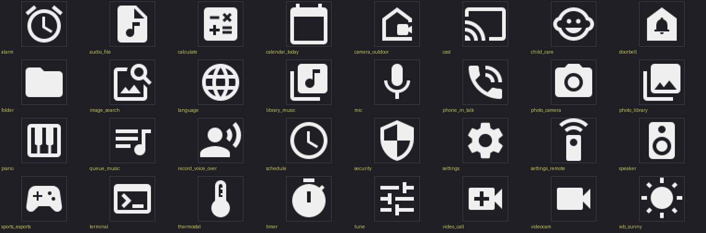

# iconkit

iconkit is the part of OmniPython that gives a program Material Design icons as
antialiased 8-bit alpha masks. Frozen into MicroPython-compatible firmware, an
icon lives in flash and costs no RAM, and it draws in LVGL or in pygraphics on
MicroPython-compatible boards, CircuitPython-compatible boards and CPython.

```bash
pip install -i https://test.pypi.org/simple/ --extra-index-url https://pypi.org/simple/ omnipython-iconkit
```

On a board, freeze it: `include("/path/to/pydevices/packages/iconkit")` from your
firmware's `manifest.py`. Without freezing, the masks load into RAM when
imported, so freeze them on a board that is short of it.

```python
import iconkit

print(len(iconkit.names(24)), "icons at 24 px,", len(iconkit.names(48)), "at 48 px")

# A mask is w * h alpha bytes, row by row. Print every other row as text.
data, w, h = iconkit.mask("home", 24)
for y in range(0, h, 2):
    row = data[y * w:(y + 1) * w]
    print("".join(" .:#"[a * 4 // 256] for a in row))
```

```text
128 icons at 24 px, 32 at 48 px
                        
                        
          :##:          
        ########        
      ############      
   .################.   
     ##############     
     #####    #####     
     #####    #####     
     #####    #####     
                        
                        
```

The picture at the top of this page is the 48 px set. Every icon in both sets is
on the [contact sheets](docs/reference/icons.md).

[Docs](docs/reference/icons.md) · [Examples](https://pydevices.github.io/gallery/pyscript/) · [Roadmap](ROADMAP.md)

OmniPython is made by [PyDevices](https://pydevices.com).

## The icons

Two sets ship, filled style, from Google's
[Material Design Icons](https://github.com/google/material-design-icons) (Apache
License 2.0, [LICENSE-ICONS](LICENSE-ICONS)):

- 24 px: 128 general-purpose icons (72 KB), listed in [icons_24.txt](lib/iconkit/icons_24.txt).
- 48 px: 32 app-tile icons (72 KB), listed in [icons_48.txt](lib/iconkit/icons_48.txt). All 32 are in the 24 px set too.

Names are Material's own (`home`, `wifi`, `battery_charging_full`). WiFi
strength comes as `network_wifi_1_bar`, `network_wifi_2_bar`,
`network_wifi_3_bar` and `network_wifi`.

## Draw an icon

In LVGL, an icon is an `lv.image` in the colour you give it:

```python
import lvgl as lv
from iconkit import lvicons

lvicons.image(lv.screen_active(), "settings", size=48, color=lv.color_hex(0x40A0FF))
```

In pygraphics, `draw` blends the icon over what the framebuffer already shows.
It needs a pygraphics with `FrameBuffer.blit_alpha`, and raises without it:

```python
from iconkit import gfx

gfx.draw(display, "home", 10, 10, 0xFFFF)
```

A display with no framebuffer can take the icon blended onto a flat background
as an RGB565 buffer: `gfx.rgb565("home", color, bg)`. Pass the returned buffer
back as `buf=` to reuse it.

`iconkit.mask("home")` gives the raw `(data, w, h)` for anything else: `data` is
a memoryview of `w * h` alpha bytes, row by row.

An unknown name or size raises `ValueError` and lists what exists.

## Your own icons

[tools/make_icons.py](tools/make_icons.py) builds a module in the same format from
any Material icon names. It needs Pillow and a Material Design Icons checkout,
which you name on the command line:

```bash
python tools/make_icons.py path/to/material-design-icons --size 24 \
    --names home,wifi,sd_card --out myicons.py
```

Put `myicons.py` in your app and register it:

```python
import iconkit
import myicons

iconkit.add(myicons)
iconkit.mask("sd_card")
```

A name that another module of the same size already has raises `ValueError`.
`--names-file` takes a list with one name per line and `#` comments, and
`--budget 72k` fails the run when the masks outgrow a size you set.

## Fetch only the icons you need

The full repository is several gigabytes. A sparse checkout fetches just the PNGs
of one size:

```bash
git clone --filter=blob:none --depth 1 --no-checkout https://github.com/google/material-design-icons.git
cd material-design-icons
git sparse-checkout set --no-cone /LICENSE '/png/*/*/materialicons/24dp/1x/'
git checkout
```

That downloads about 125 MB (git's pack of the file listing, plus the 2,170 icons
at 24 px, which are 430 KB themselves). Git still writes an index of the whole
tree, so expect about 800 MB on disk. Each further size is one more pattern, and
adds 2,170 files and about 0.7 MB:

```bash
git sparse-checkout add '/png/*/*/materialicons/48dp/1x/'
```
