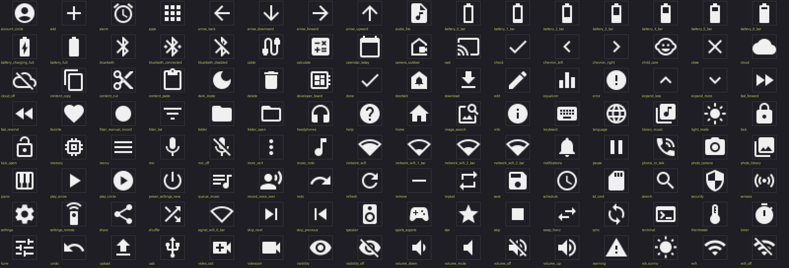
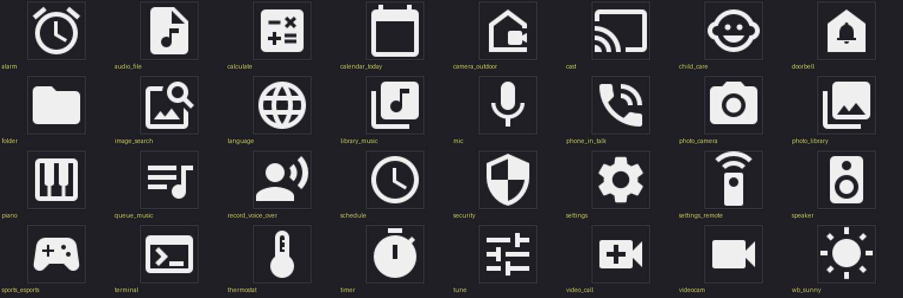

# Icons

iconkit has two sets of Material icons, and every name in them is what you
write in an app's `"icon"` field or pass to `iconkit.mask()`.

Use the 24 px set for any interface: buttons, status bars, lists. It has 128
icons.



Use the 48 px set for an app's tile on the home screen. It has 32 icons, and
all of them are in the 24 px set too, so a small screen can draw the same
name at the smaller size. An app's `"icon"` must be one of these.



The lists as text are [icons_24.txt](../../lib/iconkit/icons_24.txt) and
[icons_48.txt](../../lib/iconkit/icons_48.txt); how to draw an icon, or build
your own, is in the [iconkit README](../../README.md).

## Rebuild the sheets

With Pillow installed, from the package folder:

```bash
python tools/icon_sheets.py docs/reference/icons
```
