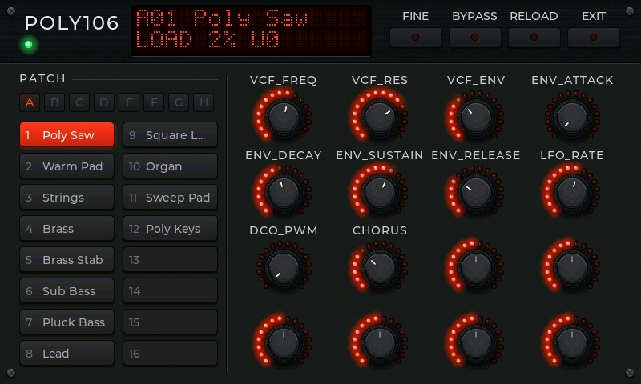

# synthstation

Synth Station is the PyDevices app that plays OmniPython's instruments from
a MIDI keyboard: pick one of audioinstruments' synthesizers, organs, pianos
or drum machines, then play it, with controlpanel's front panel to turn its
knobs, on MicroPython-compatible boards and on CPython.

```python
import mip
mip.install("synthstation", index="https://pydevices.github.io/lib")
```

```bash
pip install -i https://test.pypi.org/simple/ --extra-index-url https://pypi.org/simple/ pydevices-synthstation
```

It's an appkit app. Put it in an app set, or run it on its own on a board
or a computer with a display and an audio out:

```python
import appkit

appkit.run("synthstation")
```

with an `apps/synthstation/` folder holding an `app.json` of
`{"name": "synthstation", "title": "Synth Station"}` and an `__init__.py` of
`from synthstation import main`
([the example](examples/synthstation_app) is that). You get a list of
instruments on three tabs; pick one and you get its panel, above.

[Examples](examples) · [Roadmap](ROADMAP.md) · [Changelog](CHANGELOG.md)

## Play it

- **On a board with a USB host port** (an ESP32-S3 or ESP32-P4), plug in
  keyboards and controllers, through a hub if you like. Every one is heard
  at once, including one plugged in while the app runs.
- **On Windows or Linux**, every MIDI input port the computer has is heard:
  a USB keyboard, a loopback from a DAW or a sequencer. It needs
  [midiports](../midiports).
- **With no keyboard**, the panel says NO MIDI under the name, and the
  pads in bank A play notes: the kit's voices on a drum machine, two
  octaves of C major on anything else. The patches move to bank B.

Velocity, pitch bend and the instrument's own controllers go through.
Knobs that send controllers 70 to 77 (the MIDI spec's Sound Controllers 1
to 8, which many keyboards' knobs send) move the first eight macros, and
the panel's encoders follow. A program change picks the patch and lights
its pad. EXIT goes back to the list; RELOAD builds the instrument again,
keeping its patch and knobs.

## The load readout

While nothing else is on it, the display's second line reads
`LOAD 42% U0`. LOAD is how long the last half second of audio took to
render, as a share of how long it lasts: under 100% keeps up, over 100%
can't. U counts the times the speaker ran out of audio since the
instrument was picked. Every five seconds the same figures, with the
slowest single block, go to the console:

```text
synthstation: poly106 load 87% peak 120% underruns 3 starved 40 ms
```

So the app doubles as a bench tool for an instrument on a slow board.

## Sound out

On a board whose `board_peripherals` publishes `AUDIO_OUT` with an I2S
wire, the audio pump plays the instrument on its own core, straight into
I2S, and the board's `audio_power` turns the codec on. Elsewhere it plays
through the board config's `audio_out`. Instruments run at 48 kHz stereo,
the rate they're designed and tested at.

## Tests

From this folder:

```bash
python -m unittest discover -s tests -p 'test_*.py' -v
```

They open, play and close every instrument with a stand-in keyboard and
speaker, on CPython and on unix MicroPython (`PYDEVICES_MICROPYTHON`
names one with LVGL and audiodsp).

Made by [PyDevices](https://pydevices.com).
