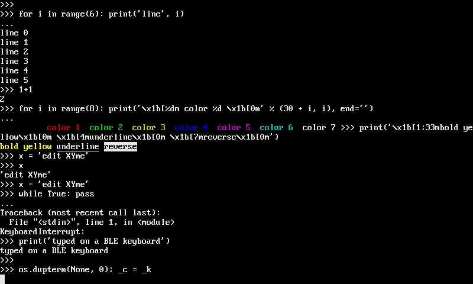

# vtterm

vtterm is the part of OmniPython that turns a display into a terminal: a
VT100 with ANSI colors, for a board's own REPL or another device's, on
MicroPython-compatible boards, CircuitPython-compatible boards and CPython.

On a board, with `mip`:

```python
import mip
mip.install("github:PyDevices/pydevices/packages/vtterm")
```

It draws with pygraphics and takes its colors from palettes' ANSI palette,
both built into OmniPython MP firmware. This puts the board's REPL on its
display, in color:

```python
from board_config import display_drv
from vtterm import Terminal
from vtterm.console import Console

terminal = Terminal(display_drv)
terminal.write(b"\x1b[1;32mvtterm\x1b[0m is ready\r\n")

console = Console(terminal)
console.attach()
print("The REPL is on the display.")
```

The display shows "vtterm is ready" in bold green, then the REPL's prompt and
everything you type over USB.

[Docs](../../docs/guides/vtterm.md) · [Examples](../../examples/vtterm_simpletest.py) · [Roadmap](../../ROADMAP.md)

OmniPython is made by [PyDevices](https://pydevices.com).
