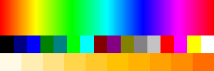

# palettes

palettes is the part of OmniPython that turns a palette index into a color a
display, LED or terminal can use: wheels, cubes, Material Design swatches and
the sixteen Windows names, with the same code on MicroPython-compatible boards,
CircuitPython-compatible boards and CPython. It has no dependencies.

```bash
pip install -i https://test.pypi.org/simple/ --extra-index-url https://pypi.org/simple/ pydevices-palettes
```

```python
import mip
mip.install("palettes", index="https://PyDevices.github.io/mip")
```

```python
from palettes import get_palette

# A 360-step color wheel, ready to write to an RGB565 display
wheel = get_palette(name="wheel", length=360, color_depth=16)
print("red, green, blue as RGB565: 0x%04X 0x%04X 0x%04X" % (wheel[0], wheel[120], wheel[240]))

# Named colors, by attribute
win16 = get_palette(name="default", color_depth=24)
print("RED is 0x%06X, and its name back again is %r" % (win16.RED, win16.color_name(12)))

# Material Design, 0xRRGGBB
md = get_palette(name="material_design", color_depth=24)
print("Amber 500 is 0x%06X" % md.AMBER_S500)
```

```text
red, green, blue as RGB565: 0xF800 0x07E0 0x001F
RED is 0xFF0000, and its name back again is 'Red'
Amber 500 is 0xFFC107
```

The picture at the top of this page is those three palettes drawn as bands: the
wheel, the sixteen Windows names and the Amber ramp.

[Docs](https://palettes.readthedocs.io) · [Examples](https://pydevices.github.io/pydevices-examples/pyscript/) · [Roadmap](ROADMAP.md)

OmniPython is made by [PyDevices](https://pydevices.com).
