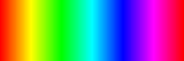
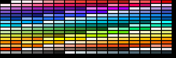
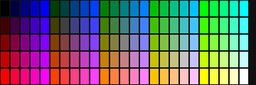
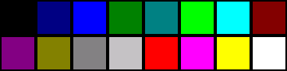

# Palette families

The four palette families `get_palette` builds, with what each takes and what it holds. [Choose a palette](guides/choose-a-palette.md) says which to use.

| Family | Class | Key | Primary Use Case |
|:---|:---|:---|:---|
| **Color Wheel** | `WheelPalette` | `"wheel"` | Continuous color ramps, hue sweeps, rainbows, circular gauges |
| **Material Design** | `MDPalette` | `"material_design"` | Modern UI widget theming, semantic status colors, contrast shades |
| **Color Cube** | `CubePalette` | `"cube"` | Quantized 8, 27, 64, or 125 color spaces for dithering and Retro UIs |
| **Windows-16** | `Palette` | `"default"` | Standard named 16-color ANSI/Windows retro palette |

## Color Wheel (`"wheel"`)

`WheelPalette` generates an evenly spaced rainbow ramp by stepping through HSV hues while maintaining constant saturation and value.



```python
from palettes import get_palette

# 256-step wheel at full saturation
wheel = get_palette("wheel", color_depth=16, length=256, saturation=1.0)

# Access color at index
color_50 = wheel[50]
```

### Parameters
* `length` (int): Number of steps around the hue circle (default `256`).
* `saturation` (float): Color saturation between `0.0` (grayscale) and `1.0` (vibrant, default `1.0`).
* `value` (float): Brightness multiplier between `0.0` and `1.0` (default `1.0`). Passing `saturation=None` and `value=None` together selects the classic three-segment wheel instead of the HSV ramp.
* `cached` (bool): Memoize each computed color (default `True` for the wheel and the cube).
* `color_depth` (int): Bit depth — `4` (palette index), `8` (RGB332), `16` (RGB565) or `24` (`0xRRGGBB`). See [Color formats](color-formats.md).
* `swapped` (bool): If `True`, swap bytes in 16-bit RGB565 for SPI display hardware.

## Material Design (`"material_design"`)

`MDPalette` provides Google's Material Design color palette with 19 hue families, each containing shades from `50` (lightest) to `900` (deepest), most also with the accent shades `A100`, `A200`, `A400` and `A700`, plus `BLACK` and `WHITE`: 256 colors in all.



```python
from palettes import get_palette

md = get_palette("material_design", color_depth=16)

# Shades are attributes: <FAMILY>_S<shade>, accents <FAMILY>_A<shade>.
header_bg = md.BLUE_S500  # 0x24BE -- primary brand color
card_bg   = md.BLUE_S50   # 0xE79F -- light tint background
accent_fg = md.BLUE_A400  # 0x2BDF -- vivid accent
```

### Available Color Families
Attribute prefixes: `RED`, `PINK`, `PURPLE`, `DEEP_PURPLE`, `INDIGO`, `BLUE`, `LIGHT_BLUE`, `CYAN`, `TEAL`, `GREEN`, `LIGHT_GREEN`, `LIME`, `YELLOW`, `AMBER`, `ORANGE`, `DEEP_ORANGE`, `BROWN`, `GREY`, `BLUE_GREY` -- each with `_S50`..`_S900` shades; every family but `BROWN`, `GREY` and `BLUE_GREY` also has `_A100`, `_A200`, `_A400` and `_A700` accents. The bare family name (for example `md.BLUE`) is its 500 shade.

## Color Cube (`"cube"`)

`CubePalette` divides the RGB color space into equal steps along each axis ($N \times N \times N$).



`size=` is the edge length — the steps per channel — and must be 2 to 5.
The first column is what you pass; the second is what you get.

| `size=` argument | Total Colors | Steps per Channel (R, G, B) | Typical Use |
|:---|:---|:---|:---|
| **2** | 8 | 2 steps (0, 255) | 3-bit primary colors |
| **3** | 27 | 3 steps (0, 128, 255) | Ultra-compact retro UIs |
| **4** | 64 | 4 steps (0, 85, 170, 255) | 6-bit color quantization |
| **5** | 125 | 5 steps (0, 64, 128, 192, 255) | High-fidelity dithering |

```python
# size is the steps per channel: size=4 -> 4x4x4 = 64 colors
cube = get_palette("cube", color_depth=16, size=4)
```

## Named Windows-16 (`"default"`)

The standard 16-color ANSI/Windows palette accessible by name or integer index.



```python
from palettes import get_palette

win16 = get_palette("default", color_depth=16)

black  = win16.BLACK    # 0x0000
red    = win16.RED      # 0xF800
green  = win16.GREEN    # 0x0400
blue   = win16.BLUE     # 0x001F
yellow = win16.YELLOW   # 0xFFE0
white  = win16.WHITE    # 0xFFFF

win16[0]              # integer indexing works too -> 0x0000
win16.color_name(0)   # "Black"
```
