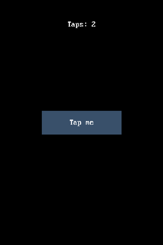

# Your first program

This program puts a label and a button on the screen and counts clicks. It
runs unchanged on a desktop and on a board, because everything that differs
between them is in the board config.

```python
import board_config
import appdev
import pdwidgets as pd

app = appdev.App(board_config)
display = pd.Display(board_config.display_drv, app)
screen = pd.Screen(display, bg=0x0000)

label = pd.Label(screen, value="Taps: 0", align=pd.ALIGN.TOP, y=40, bg=screen.bg)
button = pd.Button(screen, label="Tap me", align=pd.ALIGN.CENTER, w=160, h=50)
taps = 0

def on_tap(sender, event):
    global taps
    taps += 1
    label.value = f"Taps: {taps}"
    print(label.value)

button.add_event_cb(pd.events.MOUSEBUTTONUP, on_tap)
app.run()
```

Save it as `hello.py` and run it with `python hello.py` on a desktop, or copy
it to a board and run it there. It opens a window, and each click on the
button prints a line:

```text
Taps: 1
Taps: 2
Taps: 3
```

After three clicks the window looks like this:



## What each part does

`appdev.App(board_config)` is the application. It reads the board config's
display and input devices and runs the loop that polls them.

`pd.Display(board_config.display_drv, app)` joins a display driver to the app.
It routes input to widgets and draws the ones that changed. `pd.Screen` is one
full-display page, and every widget you create takes its parent as the first
argument.

`pd.Label` shows text and `pd.Button` is the clickable control. A label's text
is `value=` and a button's is `label=`; neither takes `text=`. A widget's
`align` says which spot in its parent it hangs from, and `x` and `y` move it
from that spot. `Label` and `Button` differ here: a label aligns to the center
unless you say otherwise, so the label above asks for `ALIGN.TOP`. See
[Lay out widgets](../guides/lay-out-widgets.md).

The label gets `bg=screen.bg` so that when its text changes, the old text is
painted over. Without a background a label draws on top of what was there, and
the digits pile up.

`add_event_cb(event_type, callback)` calls `callback(sender, event)` when the
widget gets that event. `MOUSEBUTTONUP` fires when a click or a touch lifts off
the button. [Respond to input](../guides/respond-to-input.md) covers the rest.

`app.run()` blocks until the app quits, delivering timers and input as it
goes. It's optional where the host already owns a loop that keeps the program
running, such as a REPL started with `-i`, a browser page or a notebook, and
there it returns at once.

## Next

- [Lay out widgets](../guides/lay-out-widgets.md) so a screen fits any panel.
- [Respond to input](../guides/respond-to-input.md) for taps, keys and encoders.
- [Theme an app](../guides/theme-an-app.md) to change its colors.
- [Widgets](../widgets.md) lists all 49 widgets.
